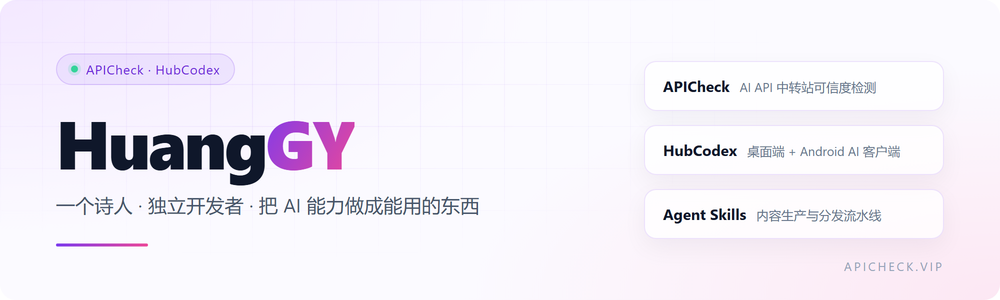

  

我的网站：https://apicheck.vip

📫 怎么找到我：

- 📧 [yggnauh@gmail.com](mailto:yggnauh@gmail.com)
- 小红书：你的主页链接（待填）
- 微信：你的微信号（待填）

我在做的东西：

- [APICheck](https://apicheck.vip) — AI API 中转站可信度检测与服务商参考排行，一次检测看清模型真实性、响应质量与入口可用率。
- [HubCodex 枢码AI](https://github.com/hgy403582754/hubcodex-releases) — 桌面端 + Android 端 AI 客户端，统一接入 Claude / OpenAI / Gemini / Grok 订阅。
- [Sub2API 网关](https://github.com/hgy403582754/sub2apiHGY) — 二次开发的生产网关，支持拼车共享与额度计费。

## Featured Skills

我做的一些 AI Agent 技能，把内容生产和分发串成一条流水线。

| Skill | What it does | Stars |
| --- | --- | --- |
| [content-launch-skill](https://github.com/hgy403582754/content-launch-skill) | 一篇文稿 → 小红书 / 抖音 / B站 / 快手的原生标题、正文与真实话题标签，自动填到草稿态。 |  |
| [cheat-on-content](https://github.com/hgy403582754/cheat-on-content) | 选题校准：把每条内容变成可校准实验，打分 → 盲预测 → 复盘 → 进化。 |  |

[看更多仓库 →](https://github.com/hgy403582754?tab=repositories)
